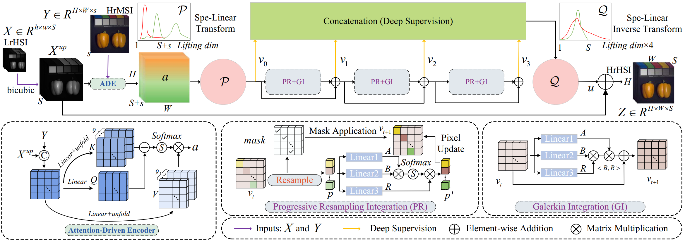

# Arbitrary‑Scale Spatial–Spectral Fusion using Kernel Integral and Progressive Resampling

> 源码发布版不包含模型权重、原始数据集和训练大日志。运行训练或测试前需准备对应数据；测试还需提供与模型配置匹配的 checkpoint。源码导出及 GitHub 上传步骤见 [GITHUB_UPLOAD.md](GITHUB_UPLOAD.md)。

> **Note:** This manuscript is currently under review.
> Full training‐code details will be released immediately upon acceptance.

---

## 🍗 Model

* You can find detailed model architecture information here:
  

```bash
cd Assets/Model
```

---

## 📂 Dataset

* **Training data & Testing data:**
  [CAVE Dataset](https://pan.baidu.com/share/init?surl=CXCJfzp2yfvJZ9Lg2i-mNA)
  *Extraction code: `dju8`*

---

## ▶️ Quick Test

Clone or navigate into the `CAVE` directory and run the demo:

```bash
cd CAVE
python Test.py
```

---

## 📊 Quantitative Results on CAVE ×4

The numerical results under the ×4 CAVE dataset.

| Methods         | PSNR       | P-Value | SAM       | P-Value | ERGAS     | P-Value |
| --------------- | ---------- | ------- | --------- | ------- | --------- | ------- |
| Bicubic         | 34.96±3.69 | <0.001  | 4.15±1.32 | <0.001  | 5.16±1.08 | <0.001  |
| DHIF-Net        | 50.79±3.68 | <0.001  | 1.94±0.57 | <0.001  | 0.86±0.51 | <0.001  |
| PSRT            | 51.76±3.45 | <0.001  | 2.05±0.65 | <0.001  | 0.79±0.49 | <0.001  |
| DSPNet          | 50.93±3.53 | <0.001  | 2.17±0.62 | <0.001  | 0.86±0.46 | <0.001  |
| BDT             | 52.41±3.37 | <0.001  | 1.98±0.64 | <0.001  | 0.85±0.49 | <0.001  |
| MIMO-SST        | 51.33±3.55 | <0.001  | 2.22±0.61 | <0.001  | 0.85±0.48 | <0.001  |
| DCINN           | 52.66±3.47 | ≈0.001  | 1.87±0.59 | <0.001  | 0.75±0.48 | <0.001  |
| SFNO            | 52.71±3.49 | –       | 1.85±0.58 | –       | 0.72±0.46 | –       |
| **F-statistic** | 28.959     | <0.001  | 10.859    | <0.001  | 67.844    | <0.001  |

---

## 📊 Quantitative Results on CAVE ×8

The numerical results under the ×8 CAVE dataset.

| Methods         | PSNR       | P-Value | SAM       | P-Value | ERGAS     | P-Value |
| --------------- | ---------- | ------- | --------- | ------- | --------- | ------- |
| Bicubic         | 30.31±3.47 | <0.001  | 5.67±1.75 | <0.001  | 8.36±1.62 | <0.001  |
| DHIF-Net        | 47.59±4.20 | <0.001  | 2.55±0.67 | <0.001  | 1.33±0.35 | <0.001  |
| PSRT            | 48.84±3.78 | <0.001  | 2.41±0.77 | <0.001  | 1.22±0.34 | <0.001  |
| DSPNet          | 48.73±3.95 | <0.001  | 2.42±0.77 | ≈0.001  | 1.12±0.34 | <0.001  |
| BDT             | 49.15±3.67 | <0.001  | 2.41±0.79 | <0.001  | 1.19±0.33 | <0.001  |
| MIMO-SST        | 48.83±3.92 | <0.001  | 2.78±0.73 | <0.001  | 1.14±0.34 | <0.001  |
| DCINN           | 49.48±4.01 | <0.001  | 2.49±0.71 | <0.001  | 1.05±0.34 | <0.001  |
| SFNO            | 50.04±4.12 | –       | 2.29±0.73 | –       | 1.00±0.34 | –       |
| **F-statistic** | 29.412     | <0.001  | 15.185    | <0.001  | 152.279   | <0.001  |

---

## 📊 Quantitative Results on Chikusei ×4

The numerical results under the ×4 Chikusei dataset.

| Methods         | PSNR       | P-Value | SAM       | P-Value | ERGAS     | P-Value |
| --------------- | ---------- | ------- | --------- | ------- | --------- | ------- |
| Bicubic         | 39.23±4.62 | <0.001  | 2.78±0.94 | <0.001  | 5.86±2.05 | <0.001  |
| DHIF-Net        | 42.61±3.12 | <0.001  | 2.29±0.77 | <0.001  | 3.78±0.65 | <0.001  |
| PSRT            | 43.78±3.64 | <0.001  | 2.23±0.80 | <0.001  | 3.49±1.30 | <0.001  |
| DSPNet          | 43.88±3.04 | <0.001  | 2.02±0.80 | <0.001  | 3.27±0.71 | <0.001  |
| BDT             | 44.32±2.95 | <0.001  | 1.84±0.82 | <0.001  | 2.97±0.68 | ≈0.001  |
| MIMO-SST        | 44.23±3.01 | <0.001  | 2.04±0.82 | <0.001  | 3.11±0.70 | <0.001  |
| DCINN           | 44.85±3.29 | <0.001  | 1.92±0.77 | <0.001  | 3.15±0.78 | <0.001  |
| SFNO            | 45.51±2.87 | –       | 1.72±0.70 | –       | 2.80±0.58 | –       |
| **F-statistic** | 3.324      | <0.001  | 3.696     | <0.001  | 8.815     | <0.001  |

---

## 📊 Quantitative Results on Chikusei ×8

The numerical results under the ×8 Chikusei dataset.

| Methods         | PSNR       | P-Value | SAM       | P-Value | ERGAS     | P-Value |
| --------------- | ---------- | ------- | --------- | ------- | --------- | ------- |
| Bicubic         | 35.56±5.02 | <0.001  | 4.05±1.02 | <0.001  | 8.98±1.50 | <0.001  |
| DHIF-Net        | 41.25±3.27 | <0.001  | 3.74±0.77 | <0.001  | 7.37±0.44 | <0.001  |
| PSRT            | 43.24±4.19 | <0.001  | 3.67±0.79 | <0.001  | 4.75±0.92 | ≈0.001  |
| DSPNet          | 42.47±3.30 | <0.001  | 3.20±0.78 | <0.001  | 6.18±0.47 | <0.001  |
| BDT             | 43.10±3.09 | <0.001  | 2.99±0.84 | <0.001  | 5.86±0.41 | <0.001  |
| MIMO-SST        | 42.91±3.29 | <0.001  | 2.91±0.80 | <0.001  | 5.18±0.54 | <0.001  |
| DCINN           | 43.27±3.61 | ≈0.001  | 2.55±0.77 | <0.001  | 5.15±0.50 | <0.001  |
| SFNO            | 44.32±3.00 | –       | 2.45±0.79 | –       | 4.36±0.38 | –       |
| **F-statistic** | 5.655      | <0.001  | 4.943     | <0.001  | 43.076    | <0.001  |

---

## 📊 Quantitative Results on Pavia Centre ×4

The numerical results under the ×4 Pavia Centre dataset.

| Methods         | PSNR       | P-Value | SAM       | P-Value | ERGAS     | P-Value |
| --------------- | ---------- | ------- | --------- | ------- | --------- | ------- |
| Bicubic         | 28.04±5.55 | <0.001  | 6.34±0.56 | <0.001  | 7.43±3.02 | <0.001  |
| DHIF-Net        | 41.64±2.56 | <0.001  | 3.43±0.97 | <0.001  | 2.14±0.79 | <0.001  |
| PSRT            | 40.58±3.83 | <0.001  | 3.96±0.95 | <0.001  | 2.36±2.11 | <0.001  |
| DSPNet          | 41.62±2.55 | <0.001  | 3.46±0.98 | <0.001  | 2.29±0.96 | <0.001  |
| BDT             | 43.17±2.53 | <0.001  | 3.25±1.00 | <0.001  | 1.97±0.87 | <0.001  |
| MIMO-SST        | 42.43±2.47 | <0.001  | 3.35±1.03 | <0.001  | 2.06±0.92 | <0.001  |
| DCINN           | 43.30±3.11 | <0.001  | 3.19±0.95 | <0.001  | 1.91±1.08 | <0.001  |
| SFNO            | 43.81±2.25 | –       | 3.10±0.82 | –       | 1.85±0.70 | –       |
| **F-statistic** | 24.974     | <0.001  | 13.680    | <0.001  | 15.694    | <0.001  |

---

## 📊 Quantitative Results on Pavia Centre ×8

The numerical results under the ×8 Pavia Centre dataset.

| Methods         | PSNR       | P-Value | SAM       | P-Value | ERGAS      | P-Value |
| --------------- | ---------- | ------- | --------- | ------- | ---------- | ------- |
| Bicubic         | 25.08±6.57 | <0.001  | 8.39±0.29 | <0.001  | 10.35±1.38 | <0.001  |
| DHIF-Net        | 40.65±2.34 | <0.001  | 3.70±0.87 | <0.001  | 2.22±0.53  | <0.001  |
| PSRT            | 40.08±4.60 | <0.001  | 4.08±0.81 | <0.001  | 2.56±1.50  | <0.001  |
| DSPNet          | 37.51±2.65 | <0.001  | 4.62±0.79 | <0.001  | 3.16±0.60  | <0.001  |
| BDT             | 40.22±2.51 | <0.001  | 3.79±0.89 | <0.001  | 2.45±0.49  | <0.001  |
| MIMO-SST        | 40.65±2.66 | <0.001  | 4.00±0.87 | <0.001  | 2.56±0.74  | <0.001  |
| DCINN           | 41.89±3.21 | <0.001  | 3.60±0.83 | <0.001  | 2.15±0.66  | <0.001  |
| SFNO            | 42.61±1.88 | –       | 3.41±0.85 | –       | 2.11±0.42  | –       |
| **F-statistic** | 24.617     | <0.001  | 42.043    | <0.001  | 101.974    | <0.001  |
