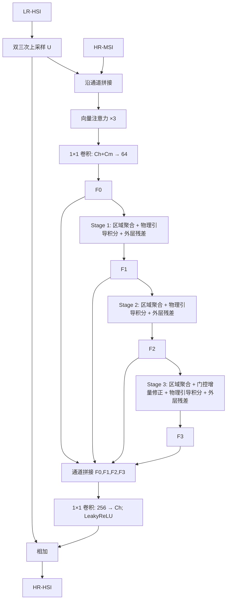

# V3-stage3 模型结构与模块说明

本文依据当前仓库实现整理，结构与命名于 2026-11-11 对照代码及 [V3-stage3 结构图](Assets/SFNO_PRGNO_V3_stage3.svg) 核对。V3-stage3 对应 `SFNO_PRGNO_V3(ablation="deform_stage3")`，用于低分辨率高光谱图像（LR-HSI）与高分辨率多光谱图像（HR-MSI）融合，输出高分辨率高光谱图像（HR-HSI）。本文描述 `guidance_mode="physics"` 且空间、光谱残差均开启的配置。

模型包含三个串联融合阶段：三个阶段均执行区域聚合、物理引导与物理引导积分，仅第三阶段执行可变形采样及门控增量修正。所有阶段保持 HR 空间尺寸。

### 图、文与代码的模块名称对应

同一个模块在图和文中统一使用以下中文名称；英文和类名用于对应代码。

| 统一名称 | 代码名称 / 实现 | 图中位置 |
|---|---|---|
| 向量注意力 | `VectorAttention` | A：前端连续三个模块 |
| 区域聚合 | `SpacingMDG`；公式中记为 $\operatorname{Regional}_j$，图中简写为 `R[j]` | A：三个阶段；B、C：模块框；D：内部结构 |
| 可变形采样 | `SpacingDeformableSampling`；公式记为 $\operatorname{Deform}_j$ | C：仅第三阶段执行 |
| 门控增量修正 | `RegionalDeformableMixing` 内的 $g_j(\operatorname{Deform}_j(F)-F)$ | A：Stage 3；C：修正模块框 |
| 物理引导 | 共享中间重建头 + `DynamicGuidance` 观测残差模块；输出为 $G_j$ | B、C：引导模块框；E：计算公式 |
| 物理引导积分 | `PhysicsGuidedGalerkin`，简称 GI | A、B、C：各阶段积分模块 |

物理引导负责从观测误差生成 $G_j$，物理引导积分使用 $G_j$ 调制特征交互，两者是不同的计算模块。图中的 `R[j]` 指区域聚合模块，公式中不带阶段下标的 $R$ 指光谱响应矩阵。

## 1. 符号与输入输出

| 符号 | 含义 | 张量尺寸 |
|---|---|---|
| $Y_h$ | LR-HSI | $B\times C_h\times h\times w$ |
| $Y_m$ | HR-MSI | $B\times C_m\times H\times W$ |
| $U$ | LR-HSI 双三次上采样结果 | $B\times C_h\times H\times W$ |
| $F_k$ | 主干特征，$k=0,1,2,3$；$F_0$ 为前端输出 | $B\times64\times H\times W$ |
| $G_j$ | 第 j 阶段的物理引导，$j=1,2,3$ | $B\times64\times H\times W$ |
| $M_j$ | 第 j 阶段进入物理引导积分的混合特征 | $B\times64\times H\times W$ |
| $\widehat X$ | 最终 HR-HSI | $B\times C_h\times H\times W$ |

实际观测间距为 $s_x=W/w$、$s_y=H/h$。代码部分变量命名为 `rgb`，本文统一称为 HR-MSI；MSI 的概念不限定为 RGB。

## 2. 整体执行顺序



上图省略了每阶段物理引导模块及其输入连线，具体计算见第 6 节。完整 SVG 中 A 为整体结构，B、C 分别展开前两个阶段和第三阶段，D、E 对应区域聚合和物理引导。

整体表达式为：

$$
U=\operatorname{Bicubic}(Y_h;H,W),\qquad
F_0=\operatorname{Conv}_{1\times1}(\operatorname{VA}_3(\operatorname{VA}_2(\operatorname{VA}_1([Y_m,U])))).
$$

三个阶段依次产生 $F_1,F_2,F_3$。最终输出为：

$$
\widehat X=U+\operatorname{LeakyReLU}_{0.2}
\left(\operatorname{Conv}_{1\times1}([F_0,F_1,F_2,F_3])\right).
$$

## 3. 前端：向量注意力（VectorAttention）×3 与通道投影

### 3.1 作用

VectorAttention 对拼接后的 HSI、MSI 特征进行局部内容自适应聚合。它为每个像素、每个通道分别预测 3×3 邻域的权重，以形成进入主干的初始融合特征。

### 3.2 单个模块的顺序

1. 无 bias 的 `1×1 Conv: C→3C` 产生 Q、K、V，其中 $C=C_h+C_m$。
2. `unfold(kernel_size=3, padding=1)` 提取 K、V 的 9 个邻居。
3. 计算中心 Q 与各邻居 K 的差。
4. 用 MLP 将差映射为 C 维注意力分数。
5. 在 9 个邻居维度进行 softmax，逐通道加权聚合 V。
6. 加上输入的 `1×1` 投影和输入残差。

$$
a_{p,\delta,c}=\operatorname{softmax}_{\delta}
\left[\operatorname{MLP}(Q_p-K_{p+\delta})\right]_c,
$$

$$
\operatorname{VA}(x)_{p,c}=\sum_{\delta\in\mathcal N_{3\times3}}
a_{p,\delta,c}V_{p+\delta,c}+\operatorname{Conv}_{1\times1}(x)_{p,c}+x_{p,c}.
$$

MLP 为 `Linear C→C → 自定义 LayerNorm → ReLU → Linear C→C`。该归一化使用最后一维的均值和标准差，分母为 `std + 1e-5`，代码采用 `unbiased=False`。

这里名为 `gate` 的层是普通 `1×1 Conv`，没有 sigmoid。邻域边界由 `unfold` 的零填充处理。

### 3.3 参数与继承关系

| 参数 | 设置 |
|---|---|
| 输入/输出维度 | $C_h+C_m$ |
| MLP 隐藏维度 | $C_h+C_m$ |
| 邻域 | 3×3，共 9 点 |
| 堆叠数量 | 3，参数互不共享 |
| 主干投影 | `1×1 Conv: Ch+Cm→64` |

VectorAttention 已存在于仓库原有 SFNO 中，V3 沿用它作为前端。向量注意力的核心思想也已有文献基础，不应把它本身描述为 V3 首次提出的机制。相关工作包括 [Exploring Self-Attention for Image Recognition，CVPR 2020](https://openaccess.thecvf.com/content_CVPR_2020/papers/Zhao_Exploring_Self-Attention_for_Image_Recognition_CVPR_2020_paper.pdf) 和 [Point Transformer，ICCV 2021](https://openaccess.thecvf.com/content/ICCV2021/html/Zhao_Point_Transformer_ICCV_2021_paper.html)。结构相似不代表已确认代码的直接来源。

源码：[VectorAttention.py](CAVE/Model/VectorAttention.py)、[FusionBackbone.py](CAVE/Model/FusionBackbone.py)。

## 4. 三个融合阶段的组织方式

与 SVG 统一，使用 $j=1,2,3$ 对应 Stage 1、2、3；第 j 阶段输入为 $F_{j-1}$，输出为 $F_j$。每阶段先根据输入特征生成中间 HSI 估计与物理引导：

$$
\widehat X_j=U+\operatorname{IntermediateHead}(F_{j-1}),\qquad
G_j=\operatorname{DynamicGuidance}(\widehat X_j,Y_h,Y_m).
$$

区域与可变形混合为：

$$
M_j=\begin{cases}
\operatorname{Regional}_j(F_{j-1}), & j=1,2,\\
\operatorname{Regional}_3(F_2)+g_3
\left(\operatorname{Deform}_3(F_2)-F_2\right), & j=3.
\end{cases}
$$

阶段输出为：

$$
F_j=\operatorname{GI}_j(M_j,G_j)+F_{j-1}.
$$

- 物理引导使用阶段输入 $F_{j-1}$ 的重建估计，与两路观测比较后生成，不从混合特征 $M_j$ 生成。
- Stage 3 的区域聚合与可变形采样都接收 $F_2$，两者并行计算，再按门控增量公式融合。
- 三个阶段的区域聚合、物理引导积分参数分别独立。
- 中间重建头与物理引导模块在三个阶段共享，每阶段仍会重新计算引导。
- Stage 1、2 的可变形模块虽然被注册、写入 checkpoint，但在此变体中不执行。

物理引导 $G_j$ 只进入物理引导积分；阶段输入 $F_{j-1}$ 通过独立残差路径，在积分输出之后相加。最终输出处还有另一条全局残差：重建头执行 `1×1 卷积 → LeakyReLU` 后再加 $U$。两类加法对应 SVG 中的显式加法节点。

源码：[SFNO_PRGNO_V3.py](CAVE/Model/SFNO_PRGNO_V3.py)、[ObservationGrid.py](CAVE/Model/ObservationGrid.py)。

## 5. 区域聚合（SpacingMDG）：多尺度局部与全局上下文融合

实际模块为 `SpacingMDG`，三个阶段均使用。它融合三个局部分支和一个全局分支。

### 5.1 归一化与三个局部分支

先进行 `ChannelLayerNorm(64)`，即在每个像素位置归一化通道维。

| 分支 | 工作网格 | 示例：HR=64×64、LR=16×16（×4） | 示例：HR=64×64、LR=8×8（×8） |
|---|---|---|---|
| 精细 | $(H,W)$ | 64×64 | 64×64 |
| 中尺度 | $(\min(H,2h),\min(W,2w))$ | 32×32 | 16×16 |
| 粗尺度 | $(h,w)$ | 16×16 | 8×8 |

表中两列是同一网格构造规则在不同观测尺寸下的示例。所有倍率复用相同的模型参数；三个局部分支始终执行，不按倍率切换为不同的分支或模型。

各局部分支均为：

```text
3×3 Depthwise Conv，64→64，padding=1，groups=64
→ GELU
→ 1×1 Conv，64→64
```

降低分辨率使用 `bilinear` 插值、`align_corners=False`、`antialias=True`；分支处理后双线性插值回 HR 网格。

父类保留 `scales=(1,2,4)` 属性，但 `SpacingMDG.forward` 的实际分支尺寸由输入 HR/LR 网格计算，不能把它描述成所有倍率下固定使用 HR、HR/2、HR/4。

#### 5.1.1 为什么可以随倍率调整工作网格

神经算子关注函数之间的映射，以及同一套参数能否在不同离散网格上使用，并不要求所有尺度下的中间特征图具有相同的像素数。严格的离散化不变性还涉及网格细化时，离散计算是否逼近一致的连续算子，不能仅用“可以输入不同尺寸”来判定。相关定义见 [Neural Operator: Learning Maps Between Function Spaces With Applications to PDEs，定义 4](https://jmlr.org/papers/volume24/21-1524/21-1524.pdf)。

当前实现采用统一规则读取实际 HR/LR 尺寸并生成工作网格：

```python
sizes = [
    (H, W),
    (min(H, 2*h), min(W, 2*w)),
    (h, w),
]
```

例如，中尺度分支在 ×4 示例中接收 32×32 特征，在 ×8 示例中接收 16×16 特征，但使用的是同一个卷积分支、同一组权重。改变的是计算网格，不是为 ×4、×8 分别训练一套参数。三个局部分支之间的参数仍分别独立；共享参数指同一个分支在不同倍率之间复用参数。

这种调整具有明确的观测含义：HR 都为 64×64 时，LR 从 16×16 变为 8×8，意味着观测更稀疏。让中、粗尺度分支跟随 LR 网格，同一个 3×3 卷积在 ×8 示例中就会覆盖更大范围的 HR 区域。该设计表达的是“观测越稀疏，部分分支在更大的空间范围内聚合信息”的建模假设，其有效性需要与固定网格等规则进行消融比较。

因此，可以将当前设计表述为：**模型在不同观测倍率下复用参数，并依据实际 HR/LR 网格调整多尺度聚合范围。** 这与跨尺度建模目标相容，但不足以单独证明整个网络具有严格的离散化不变性，或能够无条件泛化到任意尺度。固定像素邻域卷积、插值、池化等操作如何共同对应连续算子，仍需进一步分析。

还需要区分两类变化：同一个连续输入换用不同离散网格，与固定 HR 尺寸、降低 LR 观测分辨率并不完全相同。当前 ×4 训练、×8 测试改变了观测信息量及对应退化条件，验证的是该实验协议下的跨倍率重建表现；它不能替代网格细化一致性的理论分析或实验验证。核心模块可计算的网格范围，也不等同于各数据集训练、测试协议实际允许的倍率范围。

### 5.2 全局上下文分支

```text
自适应平均池化至 min(8,H) × min(8,W)
→ 展平为空间 token
→ 4 头 MultiheadAttention，embed_dim=64
→ 加池化特征
→ 1×1 Conv 64→64
→ 双线性插值回 HR
```

最多 64 个 token，每头维度为 16。此处是池化网格上的标准多头自注意力，与后面的 Galerkin 积分为两个不同模块。

三个局部分支通过不同网格上的 3×3 卷积聚合不同范围的信息；粗网格扩大了卷积对应的原图区域，但不等于让任意两个位置直接交互。全局上下文分支让池化后的所有区域 token 互相交互，补充远距离区域之间的联系。因此，该模块是“三个局部尺度 + 一个全局上下文”，并非四个结构相同的局部尺度。

这里的“全局”是当前输入特征图的范围：训练输入为 64×64 patch 时，仅覆盖该 patch；整图推理时覆盖当前整图。池化提供粗粒度上下文，局部分支保留细节；全局分支是否带来精度收益需要消融实验验证。

### 5.3 空间与通道门控

将四个对齐后的分支记为 $L_i$。

- 空间门控：拼接四分支，执行 `1×1 Conv 256→64 → GELU → 1×1 Conv 64→4`，得到每个像素的四分支 logits。
- 通道门控：对各分支做全局空间平均，再执行 `1×1 Conv 256→16 → GELU → 1×1 Conv 16→256`，重排得到每个通道的四分支 logits。

$$
w_i(c,p)=\operatorname{softmax}_{i}(s_i(p)+t_i(c)),\qquad
\sum_{i=1}^4 w_i(c,p)=1.
$$

这是在四个分支之间归一化，最终权重张量为 $B\times4\times64\times H\times W$。

### 5.4 输出与 FFN

$$
T=F+\operatorname{Conv}_{1\times1}\left(\sum_i w_i\odot L_i\right),
\qquad
\operatorname{Regional}(F)=T+\operatorname{FFN}(\operatorname{LN}(T)).
$$

FFN 为 `1×1 Conv 64→256 → GELU → 1×1 Conv 256→64`，扩张比例为 4。单个 Regional 模块参数量为 **97,876**。

源码：[ObservationGrid.py](CAVE/Model/ObservationGrid.py)、[MultiScaleDynamicGating.py](CAVE/Model/MultiScaleDynamicGating.py)。`SpacingMDG` 继承共享的 `GlobalContextDynamicGating`，使用其全局注意力与空间/通道门控构造。

## 6. 共享物理引导：观测残差与回投

独立流程图：[物理引导模块 SVG](Assets/V3_stage3_physics_guidance.svg) / [PNG](Assets/V3_stage3_physics_guidance.png)。图中 A、B 展开共享物理引导，C 展示引导如何进入各阶段的物理引导积分；C 中的 Q、K 调制层属于 GI，参数不在阶段间共享。

### 6.1 中间 HSI 估计

共享 `1×1 Conv: 64→Ch` 根据每阶段特征预测 HSI 增量：

$$
\widehat X_j=U+\operatorname{Conv}_{1\times1}^{64\to C_h}(F_{j-1}).
$$

该层 weight、bias 均为零初始化，因此初始化时三个阶段的中间估计均为 $U$。

### 6.2 空间与光谱观测残差

空间观测残差及回投：

$$
r_s=Y_h-D(\widehat X_j),\qquad b_s=D^\ast(r_s).
$$

光谱观测残差及回投：

$$
r_\lambda=Y_m-R\widehat X_j,\qquad b_\lambda=R^\top r_\lambda.
$$

$D$ 是匹配数据协议的模糊/采样算子，$D^\ast$ 为其伴随算子，不应写成逆算子。$R$ 是固定的 $C_m\times C_h$ 光谱响应矩阵，以 buffer 保存，不参与梯度优化。CAVE 的 $R$ 是由训练数据拟合的有效响应，不应称为实测传感器响应。

将两个回投残差直接相加，再提升到主干通道：

$$
G_j=\operatorname{Conv}_{1\times1}^{C_h\to64}(b_s+b_\lambda).
$$

两项之间没有独立的可学习标量权重。当前 stage3 配置同时启用空间和光谱残差，`guidance_mode="physics"`。

代码中的 `gradient` 指显式残差回投张量，不是通过 `autograd.grad` 求出的梯度，也没有在这里直接执行一次梯度下降。图中光谱残差写作 `rₘ`，对应本文的 $r_\lambda$。

### 6.3 数据集相关的空间算子

| 数据集 | 实际空间模块 | 特点 |
|---|---|---|
| CAVE | `DynamicSpatial` | 循环高斯模糊，按真实 HR/LR 比例建立周期双线性采样及伴随 |
| Chikusei | `ChikuseiSpatial` | 训练入口替换空间模块，匹配该协议的整数 ×4/×8 模糊采样及伴随 |
| Pavia | `PaviaSpatial` | 训练入口替换空间模块，匹配该协议的整数 ×4/×8 模糊采样及伴随 |

CAVE 默认 `sigma=2`，核尺寸分别由各轴实际比例四舍五入得到；非单位比例的采样坐标为 $(j+0.5)s-1$，单位比例使用恒等坐标。

Chikusei、Pavia 使用归一化高斯核，核宽为倍率，标准差为 2，采样相位为 `sf//2-1`；其当前协议限制等轴整数 ×4/×8。不能把 CAVE 空间模块的任意网格支持直接等同于另外两个数据集协议的支持范围。

FFT 在这些物理模块中用于实现模糊及其伴随；这不代表主干额外包含了一个可学习 Fourier 层。

源码：[PhysicsGalerkin.py](CAVE/Model/PhysicsGalerkin.py)、[DynamicSpatial.py](CAVE/Model/DynamicSpatial.py)、[Chikusei/run.py](Chikusei/run.py)、[Pavia/run.py](Pavia/run.py)。

## 7. 可变形采样与门控增量修正：仅 Stage 3 执行

独立流程图：[可变形采样 SVG](Assets/V3_stage3_deformable_sampling.svg) / [PNG](Assets/V3_stage3_deformable_sampling.png)。图中 A 展示间距条件与偏移、权重预测，B 展开九点采样，C 展示局部分支融合与模块内部残差，D 展示 Stage 3 的外部门控增量修正。九点权重 $\pi_i$ 与阶段门控 $g_3$ 分别标注。

实际模块为 `SpacingDeformableSampling(dim=64)`。

### 7.1 上下文预测

```text
输入 F
→ GroupNorm(num_groups=1, num_channels=64)
→ 拼接 log(sx)、log(sy) 两个常量空间通道，得到 66 通道
→ 3×3 Conv 66→64，padding=1
→ GELU
```

GroupNorm(1,64) 在单个样本的通道和空间维上联合归一化，与 Regional 中逐像素的 ChannelLayerNorm 不同。

### 7.2 九点偏移与权重

| 预测层 | 输出通道 | 含义 |
|---|---:|---|
| `offset: 1×1 Conv 64→18` | 18 | 每个像素 9 个采样点，各有 x、y 偏移 |
| `weight: 1×1 Conv 64→9` | 9 | 每个像素 9 点采样权重，沿点维 softmax |

令基准点 $b_i\in\{-1,0,1\}\times\{-1,0,1\}$，则采样位置为：

$$
p_i=p+\left(b_i+0.5\tanh(\Delta_i(p))\right)\odot(s_x,s_y).
$$

基准位置和可学习偏移均按观测间距缩放。×4 时各轴基准偏移为 −4、0、4，学习修正范围每轴小于 ±2 像素；×8 时分别为 −8、0、8 和小于 ±4 像素。

两个预测层均零初始化，所以初始为规则九点网格和均匀权重 $1/9$。九点权重在此分支内由所有特征通道共享，与 VectorAttention 的逐通道权重不同。

### 7.3 采样与局部分支融合

对归一化特征 $z$ 进行加权采样：

$$
S(p)=\sum_{i=1}^9\pi_i(p)\,z(p_i).
$$

`grid_sample` 使用双线性插值、`padding_mode="border"` 和 `align_corners=False`。坐标顺序为 x、y，采样和累加采用 FP32，逐点处理九个采样位置以限制激活大小。

同时计算一个 `3×3 Depthwise Conv 64→64` 局部分支，再执行：

$$
T=F+\operatorname{Conv}_{1\times1}^{128\to64}
([\operatorname{DWConv}(z),S]),
$$

$$
\operatorname{Deform}(F)=T+
\operatorname{FFN}(\operatorname{GroupNorm}(T)).
$$

这里 FFN 为 `1×1 Conv 64→128 → GELU → 1×1 Conv 128→64`，扩张比例为 2。单个可变形模块参数量为 **65,563**。

### 7.4 门控增量修正

Stage 3 最终混合结果为：

$$
M_3=\operatorname{Regional}_3(F_2)+g_3
\left(\operatorname{Deform}_3(F_2)-F_2\right),
\qquad g_3=\operatorname{sigmoid}(a_3).
$$

`a₃` 对应第三阶段的 `correction_logit`，为整个阶段共享的一个可学习标量，初始为 −3，因此初始 $g_3\approx0.04743$。减去输入 $F_2$，是为了提取可变形采样模块在其内部输入残差之外提供的增量。图中的 `Deform[3]` 对应 $\operatorname{Deform}_3$。

初始化的门控较小但非零，使可变形分支能够从训练开始获得梯度。该系数属于模型门控参数，不是学习率或物理残差权重。

源码：[SpacingDeformableSampling.py](CAVE/Model/SpacingDeformableSampling.py)、[SFNO_PRGNO_V3.py](CAVE/Model/SFNO_PRGNO_V3.py)。

## 8. 物理引导积分（PhysicsGuidedGalerkin / GI）

独立流程图：[物理引导积分 SVG](Assets/V3_stage3_physics_guided_integral.svg) / [PNG](Assets/V3_stage3_physics_guided_integral.png)。图中 A 展示特征投影与物理调制，B 展开每头的积分计算，C 区分 GI 内部两条混合特征残差与阶段外层的输入特征残差。图中的 $K_n$、$V_n$ 表示归一化后的 K、V。

每个阶段有独立的 `PhysicsGuidedGalerkin(midc=64, heads=8)`，输入为混合特征 $M$ 与物理引导 $G$。

### 8.1 生成并调制 Q、K

$$
(Q,K,V)=\operatorname{Conv}_{1\times1}^{64\to192}(M),
$$

$$
(\Delta Q,\Delta K)=\operatorname{Conv}_{1\times1}^{64\to128}(G),
\qquad Q'=Q+\Delta Q,\quad K'=K+\Delta K.
$$

物理引导只调制 Q、K；V 由混合特征生成。`delta_qk` 层零初始化，使初始物理调制为零。

### 8.2 多头积分计算

64 通道拆为 8 头，每头 8 维。令 $N=HW$，每头 Q、K、V 尺寸为 $N\times8$。

$$
A=\frac{\operatorname{Norm}(K')^\top\operatorname{Norm}(V)}{N},
\qquad Z=Q'A.
$$

每头核矩阵 $A$ 为 8×8；此处没有空间 $N\times N$ softmax 注意力矩阵。K、V 使用代码中的 `LastDimLayerNorm`，其分母为 `std + 1e-5`，`std` 使用 PyTorch 默认校正，与前端归一化实现不同。

### 8.3 投影与残差

$$
T=Z+M,
\qquad
\operatorname{GI}(M,G)=
\operatorname{Conv}_{1\times1}^{64\to64}
\left(\operatorname{GELU}(\operatorname{Conv}_{1\times1}^{64\to64}(T))\right)+M.
$$

第 j 阶段外层再加 $F_{j-1}$。GI 内部残差与阶段外层残差是两个实际存在的连接，画图时应区分。单个 GI 参数量为 **29,376**。

源码：[PhysicsGalerkin.py](CAVE/Model/PhysicsGalerkin.py)。

## 9. 最终重建头

拼接 $F_0,F_1,F_2,F_3$，得到 256 通道，执行：

```text
1×1 Conv 256→Ch
→ LeakyReLU(negative_slope=0.2)
→ 加上 U
→ HR-HSI
```

四级特征拼接保留不同处理深度的信息，网络最终预测上采样 HSI 基础上的增量。模型本身没有输出 sigmoid，也没有显式 clamp；个别评估脚本中的裁剪属于评估流程。

## 10. 三个数据集的结构共性与差异

Chikusei、Pavia 的 V3 入口直接导入 `CAVE/Model/SFNO_PRGNO_V3.py`，采用同一主干实现。

| 项目 | CAVE | Chikusei | Pavia |
|---|---:|---:|---:|
| HSI 通道 $C_h$ | 31 | 128 | 102 |
| MSI 通道 $C_m$ | 3 | 3 | 3 |
| 拼接/VectorAttention 维度 | 34 | 131 | 105 |
| 主干维度 | 64 | 64 | 64 |
| 中间重建头 | 64→31 | 64→128 | 64→102 |
| 光谱响应矩阵尺寸 | 3×31 | 3×128 | 3×102 |
| 最终重建头 | 256→31 | 256→128 | 256→102 |
| 可变形执行阶段 | 仅 Stage 3 | 仅 Stage 3 | 仅 Stage 3 |

各数据集使用对应的光谱响应及空间退化算子。Chikusei 的 `protocol_v2`、`protocol_v3_joint_loss` 也调用同一 V3 主干，但数据/评估和损失协议可能不同。`protocol_v3_joint_loss` 使用联合损失，不能把“所有实验只有 L1”作为统一结论。

模型支持什么输入尺寸与数据协议实际允许什么倍率，需要分别说明。核心前向依据 HR/LR 实际尺寸构建网格；如果传入 `sf`，会检查与实际尺寸是否一致。

## 11. 参数与计算量说明

以下参数量针对 CAVE 的 31+3 通道配置。

| 模块 | 数量 | 单个参数量 | 合计 |
|---|---:|---:|---:|
| 向量注意力（VectorAttention） | 3 | 7,106 | 21,318 |
| 输入投影 | 1 | 2,240 | 2,240 |
| 区域聚合（SpacingMDG） | 3 | 97,876 | 293,628 |
| 可变形采样（含未执行的注册分支） | 3 | 65,563 | 196,689 |
| 可变形修正标量 | 3 | 1 | 3 |
| 物理引导积分（GI） | 3 | 29,376 | 88,128 |
| 共享中间重建头 | 1 | 2,015 | 2,015 |
| 共享物理 lift | 1 | 2,048 | 2,048 |
| 最终重建头 | 1 | 7,967 | 7,967 |
| **注册参数总量** | | | **614,036** |

Stage 1、2 的 Deformable 与对应修正标量共 131,128 个参数不参与当前变体前向。按参与前向的参数统计为 **482,908**。注册参数量不等于当前前向实际启用的参数量；不同 HSI 通道配置的总参数量也不同。

| 变体 | Stage 1 | Stage 2 | Stage 3 | 每次模型前向的可变形 `grid_sample` 调用 |
|---|---|---|---|---:|
| V3 full | 区域聚合 + 门控增量修正 | 区域聚合 + 门控增量修正 | 区域聚合 + 门控增量修正 | 27 |
| V3-stage3 | 区域聚合 | 区域聚合 | 区域聚合 + 门控增量修正 | 9 |

减少采样调用不意味着整体推理直接加速三倍；前端、区域聚合、物理引导及 GI 等计算仍存在，耗时和显存需实测。

## 12. 训练配置示例

以下为 `Experiments/cave_continuous600/Checkpoint/cave_v3_stage3_x4_seed42/last.pth` 中核对的 600 轮实验配置，不代表所有协议。

`Experiments/sfno_restart_20261111` 与 `Experiments/sfno_corrected_20261110` 是独立的 SFNO 基线实验，不是本节的 V3-stage3 实验。例如，`sfno_restart_20261111/Checkpoint/pavia_sfno_x4_seed42/config.json` 明确记录 `model="sfno"`、有效 batch=50、初始学习率 2e-4。它的训练日志、优化配置和结果应按对应实验协议解释，不能套用本节的 V3 历史配置，也不能据其更新 V3 模型结构。

| 参数 | 设置 |
|---|---|
| `model` / `ablation` | `sfno_prgno_v3` / `deform_stage3` |
| `guidance_mode` | `physics` |
| 空间/光谱残差 | 均开启 |
| 训练倍率 | ×4 |
| HR patch / LR patch | 64×64 / 16×16 |
| batch size | 1 |
| 每轮随机 patch | 1000 |
| 总轮数 | 600 |
| 训练 seed | 42 |
| AMP | 关闭 |
| 优化器 | Adam，betas=(0.9,0.999)，eps=1e-8，weight_decay=0 |
| 损失 | 最终 HR-HSI 与真值的平均 L1 |
| 数据加载 worker | 2 |

| 训练轮次（从 1 开始） | 学习率 |
|---|---:|
| 1–200 | 1e-4 |
| 201–300 | 5e-5 |
| 301–350 | 2.5e-5 |
| 351–500 | 1.25e-5 |
| 501–550 | 6.25e-6 |
| 551–600 | 3.125e-6 |

该实验的物理残差通过引导特征影响网络，没有额外加入物理一致性损失。`size=64` 不把核心前向固定为 64×64，实际空间尺寸从输入读取；`embed=64` 与 GI 的 8 头则是当前主干代码中的固定配置。

作为特定权重的示例，该 checkpoint 中 Stage 3 的修正门控约为 0.04236；它是训练结果，不是通用超参数。门控大小本身不足以衡量分支贡献，还需考虑修正特征幅度或消融结果。

源码：[Train_V3.py](CAVE/Train_V3.py)。

## 13. 结构图与论文表述注意事项

- 使用 LR-HSI、HR-MSI、HR-HSI 命名；代码变量 `rgb` 不改变模型输入的通用定义。
- 通用结构图使用 $C_h$、$C_m$，避免将 CAVE 的 31、34 通道标注直接用于 Chikusei、Pavia。
- 前端三个 VectorAttention 均参与三个数据集的 V3-stage3 前向。
- 三个 Stage 始终保持 HR 网格；“stage3”指第三个融合阶段。
- 仅第三阶段画可变形修正；前两阶段未执行的注册分支不应画成有效计算路径。
- Regional 与 Deformable 接收同一阶段输入，以门控增量公式融合。
- 三个阶段均有物理引导；中间重建头及物理模块共享，Regional 与 GI 各阶段独立。
- Regional 的池化全局注意力和 GI 分开表示：前者 4 头、最多 64 token；后者 8 头、每头 8×8 核矩阵。
- 当前 V3 前向中没有原始 SFNO 的 Progressive Resampling Integral，不能因为名称沿袭而将它加入图中。
- 物理算子中的 FFT 模糊不是额外的可学习 Fourier 主干模块。
- VectorAttention 为沿用组件；新增设计的新颖性需要结合相关工作和实验独立论证。

现有 [V3-stage3 结构图](Assets/SFNO_PRGNO_V3_stage3.svg) 已使用通用通道标注 `Ch`、`Cm`（对应 $C_h$、$C_m$），采用通用空间算子 $D$、$D^\ast$，并明确阶段残差和最终输出的加法节点。图中阶段索引 `j=1,2,3` 与本文一致；`M[j]`、`G[j]`、`GI[j]` 分别对应 $M_j$、$G_j$、$\operatorname{GI}_j$。

## 14. 主要代码索引

当前源码的继承链为 `SFNO_PRGNO_V3 → ObservationGridBackbone → FusionBackbone`；局部、全局与空间/通道门控的共享构造已合并到 `MultiScaleDynamicGating.py`。合并保留参数路径、计算过程和随机初始化顺序，已有 V3 权重仍可严格加载。`Experiments` 中的冻结源码与历史记录保留原版本。

| 文件 | 内容 |
|---|---|
| [SFNO_PRGNO_V3.py](CAVE/Model/SFNO_PRGNO_V3.py) | 阶段开关、Regional/Deformable 门控融合 |
| [ObservationGrid.py](CAVE/Model/ObservationGrid.py) | 当前前向、SpacingMDG、动态物理引导 |
| [FusionBackbone.py](CAVE/Model/FusionBackbone.py) | 前端、共享中间头、GI 与重建头构造 |
| [VectorAttention.py](CAVE/Model/VectorAttention.py) | 局部逐通道向量注意力 |
| [MultiScaleDynamicGating.py](CAVE/Model/MultiScaleDynamicGating.py) | 局部分支、ChannelLayerNorm、FFN，以及 GlobalContextDynamicGating 的全局注意力与空间/通道门控构造 |
| [SpacingDeformableSampling.py](CAVE/Model/SpacingDeformableSampling.py) | 观测间距条件、九点偏移与采样 |
| [PhysicsGalerkin.py](CAVE/Model/PhysicsGalerkin.py) | 物理引导 GI、光谱响应与残差提升 |
| [DynamicSpatial.py](CAVE/Model/DynamicSpatial.py) | CAVE 动态空间退化及伴随 |
| [Chikusei/run.py](Chikusei/run.py) | Chikusei 模型调用及空间算子替换 |
| [Pavia/run.py](Pavia/run.py) | Pavia 模型调用及空间算子替换 |
